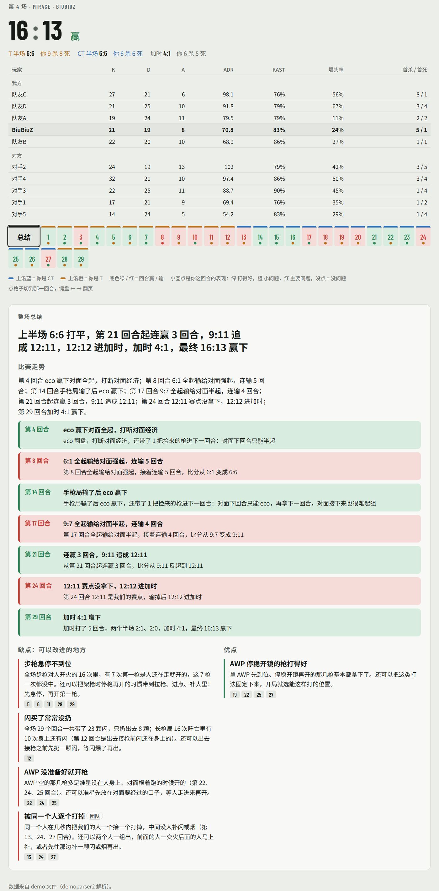
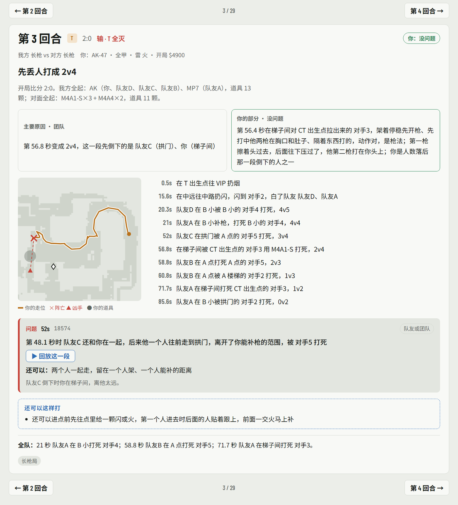
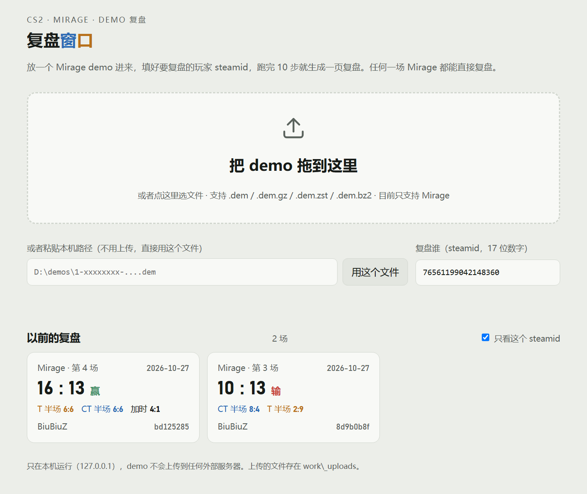
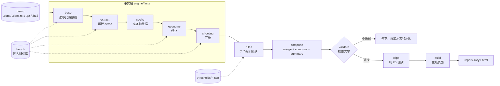

# cs2-duel-review

**CS2 Mirage 录像复盘引擎**：输入一场 Mirage 的 demo，固定 10 步跑完，输出一页逐回合的中文复盘。每回合写清楚输赢的主要原因、被复盘玩家自己做对和做错了什么、关键时刻的 2D 回放，以及"还可以怎么打"。

我是 FACEIT 玩家 BiuBiuZ。打完比赛想复盘，手动看 demo 很慢，而且容易只记住几次被打死的画面，记不住整场的规律。这个项目要回答的是：

- 这一回合是怎么输（赢）的，问题出在我、队友还是经济？
- 我每一次阵亡，是对枪动作有错、站位有问题，还是只是枪没打中？
- 整场下来，哪些毛病反复出现，哪些地方是强项？

复盘页里的每一句话都由规则和固定模板拼出来，不调用任何大模型。同一个 demo 跑两次，产出逐字节相同（开发中用 [`tools/check_determinism.py`](tools/check_determinism.py) 连跑两次核对过）。

**技术亮点**

- **确定性模板，零大模型**：规则命中 → 固定句式填空，两次运行逐字节一致，每个判断都能追到规则编号；
- **3D 视线 + spotted 判"看不看得见"**：隔楼、隔墙、隔烟都算进去，不用平面距离糊弄；
- **用 23 场对标 demo 校准规则**：11 场 FACEIT 高分局 + 12 场职业比赛，数据站不住的常见说法就改规则；
- **10 步带指纹缓存的流水线 + 文字校验**：改了哪一步只重跑哪一步之后的；生成页面前用代码检查每一句话。

> 示例页里除了我本人，所有玩家都已匿名（队友A–D、对手1–5，steamid 也换成了假的）。

---

## 目录

- [示例](#示例)
- [设计要点](#设计要点)
- [架构](#架构)
- [规则体系](#规则体系)
- [用数据检验常见说法](#用数据检验常见说法)
- [快速开始](#快速开始)
- [项目结构](#项目结构)
- [术语](#术语)
- [局限和下一步](#局限和下一步)
- [技术栈](#技术栈)
- [更多文档](#更多文档)

---

## 示例







`examples/` 里有两场真实比赛的复盘结果。HTML 是单文件，下载后用浏览器直接打开（只有字体从 Google Fonts 加载）。在 GitHub 上直接点开 `.html` 只会显示源码，要下载下来看。

下文的"第 3 场""第 4 场"是我自己打的两场 FACEIT 比赛，也就是这两个示例（第 3 场 = `8d9b0b8f`，第 4 场 = `bd125285`）；"R17"指第 17 回合。

| 文件 | 比赛 | 内容 |
|---|---|---|
| [`examples/8d9b0b8f.html`](examples/8d9b0b8f.html) | 第 3 场，23 回合，10:13 | 复盘页 |
| [`examples/8d9b0b8f.review.json`](examples/8d9b0b8f.review.json) | 同上 | 引擎输出的逐回合复盘数据 |
| [`examples/bd125285.html`](examples/bd125285.html) | 第 4 场，29 回合（有加时） | 复盘页 |
| [`examples/bd125285.review.json`](examples/bd125285.review.json) | 同上 | 引擎输出的逐回合复盘数据 |

第 3 场第 5 回合在 `review.json` 里的样子（节选）：

```text
标题      eco 翻盘止住连败；你在队友倒下后及时补枪
主要原因  （你）你打出了这回合的人数优势：第 43.4 秒打死 对手1、第 98.5 秒打死 对手5；最后是你拆包
你的部分  （打得好）队友A 倒下后，你跟上去把刚杀人的 对手1 打掉了；不过第 98.2 秒在 B 点打同在 B 点的
          对手5，AK 第一枪是跑着开的，没中；之后还是你先打中他，最后打死了他
经济栏    上回合输了，4 把步枪都没保下来，这回合钱不够全起；连输 2 回合后 eco 翻盘，止住连败，
          还带了 2 把捡来的枪进下一回合
```

整场总结里"可以改进的地方"的一条（同一场）：

```text
步枪急停不到位：全场步枪对人开火的 24 次里，有 9 次第一枪是人还在走就开的，这 9 枪一次都没中。
还可以把架枪时停稳再开的习惯带到拉枪、进点、补人里：先急停，再开第一枪。
```

---

## 设计要点

### 1. 用确定性的模板生成文字，不用大模型

复盘是要拿来改打法的，结论必须能追到 demo 里的事实，并且每次都一样。所以：

- 每条规则命中时输出一个 Hit（规则编号、责任、填句子用到的全部事实），句子按规则手册里的固定句式填空；
- "还可以……"只取规则里写好的 `alt`，引擎不自己编建议（合并层 M6）；
- 不用随机数，不读当前时间，所有遍历都显式排序。同一个 demo 跑两次，产出逐字节相同（[`engine/CONTRACT.md`](engine/CONTRACT.md)"确定性"一节；可以用 `tools/check_determinism.py` 自己验证）；
- 每个时刻、每条判断都能在 `work/<key>/hits.json` 里找到它来自哪条规则；回合时间线和开局买法直接取自 `timeline.json`。

### 2. 只用玩家当时能知道的信息判断

规则的第一条原则：判断只用玩家自己的视野、雷达（队友看见的）、击杀栏、自己打中过谁、听得到的枪声和道具声。对方血量、藏身位置、经济只能用来写后果，不能拿来说"你当时就该知道"。例如转点只有在出发前有一个玩家拿得到的信号时才夸，不用"后来 T 真的在那边下包"来倒推（[`rules/decisions_v1.md`](rules/decisions_v1.md) #25）。

### 3. 能不能看见、能不能补枪，用 3D 视线加 spotted

平面距离近不代表看得见，隔着一层楼或一堵墙就补不到枪。所有"看得见""补得上"的判断都用 3D 位置加 demo 里的 `approximate_spotted_by`，隔烟用 3D 视线和烟柱求交（"看得见""隔烟"这些口径全项目只实现一份，在 [`engine/common.py`](engine/common.py)）。

### 4. 先拿数据检验原则，数据优先于常见说法

规则背后的判断标准写在[基本功手册](engine/knowledge/handbook_v1.md)里。每条原则都写了"原则 / 为什么 / 数据 / 检测 / 引擎现状 / 改法"六项，数据来自 11 场 FACEIT 高分局和 12 场职业比赛的 Mirage demo。有些常见说法在数据里站不住，规则就跟着改，例子见[下文](#用数据检验常见说法)。

### 5. 对枪输了先分析动作

每一次被枪打死，引擎都按一张判定表给出结论（`SHOT-06`，[`engine/rules/duel.py`](engine/rules/duel.py)，手册 1.13）。判定表按顺序检查：被闪或隔烟、同时被两个人看着（这种情况归站位）、第一枪没急停、准星没提前放好、准星还在甩就开枪、先打中但打在身上而对面打头、一口气扫到底、手枪点得太快、挨了第一下没退出视线、AWP 没开镜。都没问题就写"动作对，是枪法"，不算你的责任，也不写成合理代价。

### 6. 每回合只写值得分析的点

规则命中很多，全写出来没法读。合并层（[`engine/merge.py`](engine/merge.py)）做了几件事：

- 同一次阵亡只定一次责（按固定优先级取主因，其余写成从句）；
- 同一件事只说一次；
- 亮点过滤（`_salience`，阈值在 [`engine/thresholds/salience.json`](engine/thresholds/salience.json)）：一定保留阵亡、主要原因、判到你的问题和总结引用的回合；夸奖只留亮眼的，比如开局首杀、多杀、扳回人数、赢下回合的最后一杀；
- 每回合最多 6 个时刻（`MAX_MOMENTS`）。

开发时用 21 份复盘做回归。亮点过滤加上后面几轮修正，把这 21 份的时刻总数从 937 降到了 698，这是开发记录里最后一次统计（见 [`docs/dev/COMPOSE_NOTES.md`](docs/dev/COMPOSE_NOTES.md)）。两场示例分别是 23 回合 50 个时刻、29 回合 45 个时刻。

### 7. 责任分级

每条命中都标一个责任等级：你的责任、小问题、你的责任 + 队友或团队、队友或团队、合理代价、另一种思路（不算错）。eco 局打全起、人数劣势、装备差距这类阵亡算合理代价，不硬说成你的错。队友的问题也不记到你头上。

### 8. 用代码检查文字

`validate` 是流水线里单独的一步（[`engine/validate.py`](engine/validate.py)）。它检查 `review.json` 里玩家能读到的每一句话，有一处不通过就停下，不生成页面：

- 禁用写法：坐标、速度数字、角度、百分比、伤害或血量数字、延迟秒数、"对拉 / 对架"、"B 商店"（应为超市）、英文报点名、"应该 / 必须 / 该……"等说教用词、"上帝视角 / 你当时不知道"、"雷达"、报点或沟通类建议，一共 39 条正则，另有若干专项检查；
- 反查事实：人名必须在本场名单里；"第 N 秒"必须在本回合的命中或时间线里找得到（误差 ±0.5 秒）；"$钱数"必须在经济数据或价目表里；"3v2"这类人数必须在本回合出现过；
- 每个时刻的规则编号必须在规则手册里，字段取值必须是页面认得的。

### 9. 用拍板记录和批量审核单校准规则

规则先写成手册（rules_v1），由我作为玩家审阅，有争议的地方由我拍板。拍板记录在 [`rules/decisions_v1.md`](rules/decisions_v1.md)，优先级高于手册。后期改成批量审核：把手册的改动整理成一张 36 条的审核单，我确认后统一落地；另外 21 个具体问题先按默认判法实现，之后可以再改。落地后再拿 21 份复盘逐条核对。过程见 [`docs/DEVELOPMENT_LOG.md`](docs/DEVELOPMENT_LOG.md)。

### 10. 任何 Mirage demo 都能直接复盘

第一步 `base` 只用当前这个 demo 算出这场比赛的全部底稿，不需要先"入库"。可以用 `--user` 换任何一名玩家复盘，输出互不覆盖。如果本场本身就在对标库里，对标统计会先去掉本场；被复盘的人在对标库其他场里的数据，只有在他的 steamid 没被匿名时（也就是我自己，或者不在对标库里的人）才能认出来并去掉，详见[对标数据](#对标数据)。加时（每半场 MR3）的经济和半场切分单独处理。审计和改造记录见 [`engine/GENERALITY.md`](engine/GENERALITY.md)。

---

## 架构



| 步骤 | 产出（`work/<key>/` 下） | 做什么 |
|---|---|---|
| base | `base/*.csv`（回合、位置、击杀、道具、交火、经济局面、用户交火） | 只从本场 demo 算出底稿 |
| extract | `timeline.json`、`match_overview.json` | 逐回合时间线：人数、路线、道具落点、谁先看见谁、报点中文名、计分板 |
| cache | `cache/*.pkl` 等 | 规则要用的逐帧数据：坐标、朝向、spotted、速度、事件 |
| economy | `economy.json` | 每回合双方的钱、买法、连败计数（按 demo 实测推出），以及高分局 / 职业同局面的对标 |
| shooting | `shooting.json` | 每次交火的第一枪：停没停稳、开没开镜、命中，用同一套算法和对标比较 |
| rules | `hits.json` | 7 个规则模块的全部命中 |
| compose | `review.json` | 合并命中，定主要原因和责任，写"你的部分"、时刻、经济栏、整场总结 |
| validate | — | 检查所有文字，不通过就停 |
| clips | `clips.json` | 每个时刻前 8 秒到后 2 秒的 2D 回放 |
| build | `report/<key>.html`、`meta.json` | 拼成单文件页面 |

每一步都会记一个缓存指纹：demo 大小和修改时间、用户、这一步用到的源码和阈值的哈希、上一步的指纹。指纹没变就跳过；有一步重跑，后面的步骤全部重跑；`--force` 强制全部重跑（[`engine/pipeline.py`](engine/pipeline.py)）。

| 模块 | 职责 |
|---|---|
| [`engine/facts/`](engine/facts) | 事实层：base、extract、cache、economy、shooting，只算事实，不下判断 |
| [`engine/common.py`](engine/common.py) | 13 个共用口径（时刻、报点、人数、停稳、命中、目标归属、看得见、雷达、隔烟、听得到、交火、买法、枪档）只实现这一份 |
| [`engine/rules/`](engine/rules) | 规则层：`shot`（含 `duel` 对枪动作判定）、`pos`、`team`、`util`、`timing`、`post`、`eco`，每个模块 `run(ctx) -> list[Hit]` |
| [`engine/thresholds/`](engine/thresholds) | 全部阈值，9 个 JSON 文件，规则代码里不写死数字 |
| [`engine/merge.py`](engine/merge.py) | 合并层 M1–M7、亮点过滤、主要原因、你的部分 |
| [`engine/compose.py`](engine/compose.py) | 回合标题、买法、经济栏、时间线、标签、评级，写 `review.json` |
| [`engine/summary.py`](engine/summary.py) | 整场总结：标题、比赛走势、可以改进的地方、强项 |
| [`engine/validate.py`](engine/validate.py) | 文字检查（见上） |
| [`engine/clips.py`](engine/clips.py)、[`engine/build.py`](engine/build.py) | 2D 回放切片，页面拼装（模板 `page_template.html`） |
| [`app/`](app) | 本地窗口：标准库 HTTP 服务（只监听 127.0.0.1:8770）、任务队列、10 步进度、历史复盘 |
| [`tools/anonymize.py`](tools/anonymize.py) | 把一场复盘匿名化成可公开的示例；处理完会整页回扫，还能找到原名或原 steamid 就不写出文件 |

数据约定（Ctx、Hit、review.json）和更细的流程见 [`docs/ARCHITECTURE.md`](docs/ARCHITECTURE.md)。

---

## 规则体系

规则手册 v1 有 68 条（由评审后的 86 条合并而来），后来按审核单加了 1 条对枪动作判定 `SHOT-06`，现在共 69 个规则编号，分 9 类。完整目录见 [`docs/RULES.md`](docs/RULES.md)；每条规则的触发条件、责任、固定句式和局限见 [`rules/rules_v1.md`](rules/rules_v1.md)。

| 类别 | 条数 | 例子 |
|---|---|---|
| 开枪与准星（SHOT） | 10 | 第一枪没停稳、准星没放到位、一串打空不调整、狙空枪、对枪动作判定；好的：停稳先手、打没看你的人 |
| 站位与拉枪（POS） | 10 | 杀完人不收、同一条线重复拉、人多时主动去接五五开的枪、贴着烟站被隔烟打死 |
| 团队配合（TEAM） | 10 | 功劳和人数劣势归谁、一个人先接触身后没人、能补没补、反 eco 单走送枪；好的：及时补枪 |
| 道具（UTIL） | 10 | 带着道具进死局、闪白队友、狙击线没补烟；好的：开局 A1 火、用道具拖时间 |
| 时机与转点（TIME） | 10 | 转点路上还静步、刚响过枪还一个人冲、烟快散了还慢慢横穿、进点太晚 |
| 下包后·回防·保枪（POST） | 5 | 人数劣势没保枪、回防一个人先进、人多守包时走出去找人 |
| 经济与势头（ECO） | 10 | 手枪局后的买法、该强起却 eco、反 eco 被翻、经济转折点 |
| 合理代价（COST） | 1 | 装备差距下输掉对枪 |
| 全场汇总（SUM） | 3 | 步枪急停不到位、停稳首枪命中低、强项汇总 |

下面几句摘自 `examples/` 里的两场匿名示例，原样未改，每类一句；更多例句和全部规则见 [`docs/RULES.md`](docs/RULES.md)。

- **对枪**：第 78.9 秒在 A 二楼拉出去打蹲着架 A 二楼的 对手1，AK 第一枪还在走，没中；之后先打中他两枪在胸口，他蹲着两枪都打在你头上。（第 3 场 R17，SHOT-01，你的责任）
- **站位**：第 46.6 秒起你在下水道一直从同一个点出来，和 VIP 拿 AWP 的 对手2 对枪，几次出来前后一共开了 12 枪，一枪没中，对手2 只要一直瞄着这个点就行。（第 3 场 R18，POS-03）
- **补枪与配合**：队友D 在中远被拱门的 对手3 打死时，你就贴在他身边，但看不到凶手，补不上。还可以：叠之前先往会露的方向补一颗烟；或者两个人分开、一人看一个方向，倒一个另一个能补。（第 3 场 R20，POS-06，队友或团队）
- **道具**：第 16.3 秒 4v5 时，你扔完烟后身上还有闪，你自己前面一直没和人交过火，到死都没扔，出去接枪；队友C 正在往你这边来。还可以：在 B 二楼往外走之前先扔一颗闪，等闪爆了和 队友C 一起出。（第 4 场 R12，UTIL-01，小问题）
- **经济**：上回合我们强起赢下对面全起，对面这回合只能 eco；长枪打手枪被翻，对面捡走 AK、M4A4、MP7；我们下回合只能 eco，再下回合起得很勉强，对面从第 17 回合开始每回合有狙。（第 3 场 R15，ECO-06 跨回合影响）

---

## 用数据检验常见说法

[`engine/knowledge/handbook_v1.md`](engine/knowledge/handbook_v1.md) 分六章：对枪动作、站位与补枪、道具、CT 防守、T 进攻、残局与经济。每条原则都拿对标 demo 做了统计，口径如下：

- **职业**：12 场职业比赛的 Mirage；**高分**：11 场 FACEIT 高分局的 Mirage；**用户**：我自己的 4 场；
- 距离和视线一律用 3D；大多数数字都标了样本量 n；手册明确说明这些都是相关关系，不是因果。

统计改变规则的几个例子（数字原样摘自手册）：

| 常见说法 | 数据 | 规则怎么改 |
|---|---|---|
| 死的时候身上还有道具就是浪费 | 长枪局阵亡时身上还有道具：职业 61%（814/1329），高分 63%（654/1044）。同一套引擎跑 17 份高分复盘，旧版 UTIL-01 命中了 29% 的阵亡，说明它抓到的大多是正常打法 | UTIL-01 改成五道门全部通过才判：主动出去、对面位置能预判、没人给过道具、局面不是 eco 或残局、主句不冲突（手册 UTIL-A） |
| 第一枪一定要急停 | 10 米外停稳的第一枪命中率明显更高（10–20 米 42% 对 29%）；但 10 米内没停稳的整次对枪反而赢 69% 对 62% | SHOT-01 加 10 米门槛：10 米内边走边开只计入全场统计，不单独作为一个问题时刻（手册 1.1） |
| 有 peeker's advantage，所以该主动拉 | 职业交火里拉出方占 39%、架枪方占 61%；拉出方先打中的只有 36%，架枪方 64% | 拉出去时第一枪没停稳单独判；判定表按拉枪方式选句子（手册 1.8） |
| 远处一定要点射 | 高分在 10 米内、10–20、20–30、30 米外的"第一口气"中位数都是 3 发 | 去掉"远处改成两三发一组点射"的建议，只有 20 米外一口气扫 8 发以上、只中 0–1 发才判（手册 1.6） |
| 听到枪声就该冲出去补 | 队友倒下时有人看得见凶手，3 秒内补掉的占 59%（高分、职业都是）；没人看得见时只有 9%（高分）/ 8%（职业） | 删掉 TEAM-05"只听得到"的分支，补枪只看视线（手册 POS-D） |
| 赢一回合连败计数清零 | 按 demo 实测，赢一回合计数减 2 | 经济层按实测规则推算每回合的钱（手册 ECON-A） |

手册附录 C 一共列了 14 条在数据里站不住的常见说法。

说明：手册里的统计是开发时在完整的对标 demo 上跑出来的，统计脚本和原始 demo 没有随仓库发布。仓库里的 [`bench/`](bench) 只保留引擎运行时要读的字段，而且已经匿名化，见 [`bench/README.md`](bench/README.md)。

---

## 快速开始

### 环境

- Python 3.13（开发时用 3.13.15）。只在 Windows 上测过。
- 依赖见 [`requirements.txt`](requirements.txt)：demoparser2、pandas、numpy、pyarrow，复盘 `.dem.zst` 还需要 zstandard。
- 仓库自带的对标缓存是 parquet 和 JSON（不含 pickle），clone 下来不会执行任何数据文件里的代码。引擎运行时在 `work/` 里自己生成的缓存是 pickle，只读本机生成的那份。

```bash
git clone https://github.com/a717179065-sudo/cs2-duel-review.git
cd cs2-duel-review
py -m pip install -r requirements.txt
```

### 准备 demo

仓库里**不包含任何 demo**。可以在 FACEIT 的比赛房间页面下载自己比赛的 demo，下载的压缩包（`.dem.zst` / `.dem.gz`）不用解压，引擎能直接读。其他来源的 Mirage demo（`.dem`）也能用，只是 id 取文件哈希的前 8 位，不取 FACEIT 文件名里的那 8 位。

### 命令行

```bash
# 复盘默认用户（engine/config.py 的 DEFAULT_USER）
py -I run.py path/to/1-xxxxxxxx-....dem.zst

# 复盘 demo 里的任意一名玩家（17 位 steamid）
py -I run.py path/to/match.dem --user 7656119xxxxxxxxxx

# 不用缓存，10 步全部重跑
py -I run.py path/to/match.dem --force
```

- `py -I` 是隔离模式；入口脚本会自己把仓库根目录加进 `sys.path`。非 Windows 环境用 `python3 -I`。
- 默认用户是我自己的 steamid。复盘别人时加 `--user`。要复盘的人不在 demo 里时，报错信息会列出 demo 里所有玩家的名字和 steamid。
- 退出码：0 成功；1 某一步失败；2 参数或文件不对（包括用户不在 demo 里、不是 Mirage）。

### 本地窗口

双击 `启动复盘窗口.bat`（或运行 `py -I app/server.py`），浏览器打开 `http://127.0.0.1:8770/`。可以拖入 demo 或填写本机路径，填上要复盘的 steamid，然后看 10 步的进度和历史复盘。服务只监听本机，只用 Python 标准库。

### 输出

| 位置 | 内容 |
|---|---|
| `report/<key>.html` | 复盘页 |
| `work/<key>/review.json` | 逐回合复盘数据 |
| `work/<key>/hits.json` | 全部规则命中（每句话的来源） |
| `work/<key>/timeline.json`、`economy.json`、`shooting.json`、`clips.json` | 中间结果 |

`<key>` 在复盘默认用户时就是 demo id；复盘其他用户时是 `<id>_<steamid>`，所以同一个 demo 换人复盘不会覆盖。`work/` 和 `report/` 已在 `.gitignore` 里。

### 对标数据

[`bench/`](bench) 是引擎运行时读的对标库：11 场 FACEIT 高分局、12 场职业比赛，以及我自己其他几场的派生数据。只保留引擎要读的字段：交火表、位置（只有坐标和报点）、每回合买法、开枪事件缓存。玩家名一律换成代号（高分玩家NN、职业选手NN、队友A–D、对手1–5），steamid 换成假的 17 位数字。用环境变量 `CS2_REVIEW_BENCH` 可以换成别的对标库。

因为对标库里的 steamid 是假的，有两个功能只对我自己（以及不在对标库里的玩家）完整生效：对标统计里"去掉被复盘的人自己"，和"你在其他场的表现"那一组对比。复盘对标库里的某位高分玩家或职业选手时，他在对标库其他场的数据会留在对标统计里，"其他场"那一组也不会出现。

另外，开发时还有一份按阵营和地点整理的报点知识库，用来给"还可以……"配句子；它不随仓库发布，引擎没有它照常运行（`hits.json` 的 `kb` 字段为空，页面不受影响）。

---

## 项目结构

```
run.py                  命令行入口
启动复盘窗口.bat         启动本地窗口
app/                    窗口：server.py（标准库 HTTP 服务 + 任务队列）、index.html
engine/
  config.py ctx.py pipeline.py       配置、运行上下文、10 步流水线和缓存指纹
  facts/                             事实层（base / extract / cache / economy / shooting）
  common.py                          C-* 共用口径
  rules/                             规则层（shot+duel / pos / team / util / timing / post / eco）
  merge.py compose.py summary.py     合并层、写复盘、整场总结
  validate.py clips.py build.py      文字检查、2D 回放、页面
  thresholds/*.json                  全部阈值
  page_template.html assets/         页面模板、Mirage 地图轮廓
  knowledge/handbook_v1.md           基本功手册（规则背后的数据）
  CONTRACT.md COMMON_API.md GENERALITY.md
rules/
  rules_v1.json rules_v1.md          规则手册 v1（68 条）
  decisions_v1.md                    拍板记录（覆盖 rules_v1）
  src/                               生成 rules_v1 的源文件和脚本
bench/                  匿名对标库
examples/               两场匿名示例
tools/anonymize.py      示例匿名化脚本
tools/check_determinism.py  同一个 demo 连跑两次，核对产出逐字节相同
docs/                   架构、规则目录、开发记录；dev/ 是各轮迭代的原始笔记
```

---

## 术语

| 词 | 意思 |
|---|---|
| eco | 这回合基本不买枪、存钱给下回合 |
| 强起 | 钱不够全套也硬买枪（例如冲锋枪、Galil 加甲） |
| 反 eco | 对面 eco、我们拿着长枪的回合，输了代价很大 |
| 补枪 | 队友被打死后马上把凶手打掉（trade） |
| 拉枪 / 架枪 | 主动从掩体后出去打（peek）/ 停在原地瞄着一个口子等人出来（hold） |
| spotted | demo 里记录的"谁此刻被谁看见"（`approximate_spotted_by`），引擎用它和 3D 视线一起判断看不看得见 |

文档里的编号：`SHOT-01`、`POS-03` 这类是规则编号；`P1–P6` 是规则原则，`M1–M7` 是合并层的规则，`C-SEEN`、`C-SMOKE` 这类是共用口径，全部定义在 [`docs/RULES.md`](docs/RULES.md)。

---

## 局限和下一步

**局限**

- **只支持 Mirage。** 报点中文名、地图轮廓、常规站位表、很多规则的地点条件（A1、VIP、中远、下水道……）都是按 Mirage 写的；其他地图在第一步就会报"目前只支持 Mirage"。
- **按 64 tick 写**（`config.TICKRATE`），其他 tick 率没测过。
- **没有语音。** 判断不了沟通、报点、对面的真实意图，规则也不给沟通类建议（原则 P3）。
- **demo 本身的精度有限。** spotted 是近似可见性，每 1/8 秒才更新；"听得到"只按 3D 距离近似，没考虑墙体和消音器；demo 里的准星朝向不含后坐，所以第三发以后不判准星高低（手册 1.0）。
- **阈值来自少量比赛。** 规则按我自己的水平段写，开发中用 4 场自己的比赛和 17 份高分局复盘来核对和调整阈值。换水平段、换游戏版本需要重新校准。
- **对标库是静态的。** 有几项对标（常见开枪位聚类、少数几个静态门槛）没法按场拆开，复盘对标库里的比赛时也包含本场。
- **没有完整的自动化测试。** 回归靠 21 份复盘的逐字对比和 validate；那套对比脚本在开发目录里，没有随仓库发布。仓库里只带了确定性检查 `tools/check_determinism.py`（需要自己准备 demo）。

**下一步**

- 把地图相关的东西（报点表、站位表、地点条件）从规则里抽出来，支持第二张图；
- 把三份"挪位意图"函数（`pos.move_intent`、`team._move_intent`、`timing.move_intent`）合并进 `common`；
- 把 21 份复盘的逐字对比整理成可以随仓库运行的回归测试；
- 引擎在 `work/` 里写的中间缓存也从 pickle 换成 parquet。

---

## 技术栈

- Python 3.13
- [demoparser2](https://github.com/LaihoE/demoparser) 解析 CS2 demo（逐 tick 属性和游戏事件）
- pandas、numpy 做逐帧计算，pyarrow 存 parquet 缓存，zstandard 读 `.dem.zst`
- 页面是单文件 HTML（原生 JavaScript 和 SVG，2D 回放和走位图直接画在地图轮廓上）
- 本地窗口只用 Python 标准库（`http.server` + 子进程 + 后台线程队列）

代码量约 2.3 万行 Python（`run.py`、`app/`、`engine/`、`tools/`）。

---

## 更多文档

| 文档 | 内容 |
|---|---|
| [`docs/ARCHITECTURE.md`](docs/ARCHITECTURE.md) | 流水线、缓存、数据约定（Ctx / Hit / review.json）、合并层、validate、通用性 |
| [`docs/RULES.md`](docs/RULES.md) | 69 个规则编号的目录、原则、共用口径 |
| [`docs/DEVELOPMENT_LOG.md`](docs/DEVELOPMENT_LOG.md) | 迭代过程：手写复盘、原型、引擎、通用化、拍板、手册和批量审核 |
| [`engine/CONTRACT.md`](engine/CONTRACT.md) | 模块共同遵守的约定 |
| [`engine/COMMON_API.md`](engine/COMMON_API.md) | `common.py` 的接口 |
| [`engine/GENERALITY.md`](engine/GENERALITY.md) | "任何 demo 都能复盘"的审计和改造记录 |
| [`engine/knowledge/handbook_v1.md`](engine/knowledge/handbook_v1.md) | 基本功手册 |
| [`rules/rules_v1.md`](rules/rules_v1.md)、[`rules/decisions_v1.md`](rules/decisions_v1.md) | 规则手册和拍板记录 |
| [`docs/dev/`](docs/dev) | 合并层迭代笔记、各规则模块的实现报告 |

## 许可

MIT，见 [LICENSE](LICENSE)。
