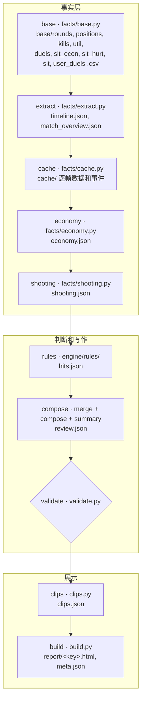

# 架构

这份文档讲引擎怎么从一个 demo 走到一页复盘：每一步读什么、写什么，模块之间约定的数据格式，以及确定性和通用性是怎么保证的。模块共同遵守的原始约定见 [`engine/CONTRACT.md`](../engine/CONTRACT.md)，`common.py` 的接口见 [`engine/COMMON_API.md`](../engine/COMMON_API.md)。

## 1. 入口

| 入口 | 用法 | 说明 |
|---|---|---|
| [`run.py`](../run.py) | `py -I run.py <demo> [--user STEAMID] [--force] [--json-progress]` | 命令行。退出码：0 成功，1 某一步失败，2 参数或输入不对 |
| [`app/server.py`](../app/server.py) | `py -I app/server.py [--port 8770]`，或双击 `启动复盘窗口.bat` | 本地窗口。只监听 127.0.0.1，只用标准库；后台线程按顺序跑子进程 `run.py --json-progress`，逐行读进度 |

两个入口都从 [`engine/config.py`](../engine/config.py) 取默认用户（`DEFAULT_USER`）。窗口的接口：

| 接口 | 作用 |
|---|---|
| `POST /api/upload` | 请求体是 demo 文件本身，文件名和 steamid 放在请求头 |
| `POST /api/local` | `{"path": 本机 demo 路径, "user": steamid}` |
| `POST /api/rerun` | 同一个 demo 换一个人重新排队（要复盘的人不在 demo 里时，点名单里的名字用） |
| `GET /api/jobs`、`/api/jobs/<id>` | 任务列表；一个任务 10 步的状态、耗时、说明、复盘页地址或失败原因 |
| `GET /api/reports[?user=]` | 已生成的复盘页（读 `work/<key>/meta.json`） |
| `GET /api/config` | 默认用户和步骤列表 |
| `GET /report/<文件>` | 复盘页（不允许 `../`） |

## 2. id 和 key

- **demo id**（`config.demo_id`）：FACEIT 文件名 `1-<8 位 hex>-….dem(.zst)` 取那 8 位，其他文件取内容 sha1 的前 8 位。改过名的 FACEIT demo 会和本地已知的 demo 按大小和内容比对，认回原来的 id，这样"对标里排除本场"不会因为改名失效。
- **key**（`config.output_key`）：复盘默认用户时 key 就是 id；复盘别的用户时是 `<id>_<steamid>`。`work/<key>/` 和 `report/<key>.html` 都按 key 分开，同一个 demo 换人复盘不会覆盖。
- 压缩的 demo（`.gz` / `.zst` / `.bz2`）解压到 `work/<id>/match.dem`，同一个 demo 的不同用户共用这一份。

## 3. 流水线

[`engine/pipeline.py`](../engine/pipeline.py) 的 `STAGES` 固定 10 步，每一步对应一个模块的 `run(ctx)`，用到时才 import。



| # | 步骤 | 显示名 | 模块 | 产出（相对 `work/<key>/`） | 计入指纹的源码 |
|---|---|---|---|---|---|
| 1 | base | 读取比赛数据 | `engine.facts.base` | `base/*.csv`（9 份） | `facts/` |
| 2 | extract | 解析 demo | `engine.facts.extract` | `timeline.json`、`match_overview.json` | `facts/` |
| 3 | cache | 准备帧数据 | `engine.facts.cache` | `cache/` | `facts/` |
| 4 | economy | 经济 | `engine.facts.economy` | `economy.json` | `facts/` |
| 5 | shooting | 开枪 | `engine.facts.shooting` | `shooting.json` | `facts/` |
| 6 | rules | 跑规则 | `engine.rules.run_all` | `hits.json` | `rules/`、`common.py`、`thresholds/` |
| 7 | compose | 写复盘 | `engine.compose` | `review.json` | `compose.py`、`merge.py`、`summary.py`、`common.py`、`validate.py`、`thresholds/`、`rules_v1.json` |
| 8 | validate | 检查文字 | `engine.validate` | — | `validate.py`、`rules_v1.json` |
| 9 | clips | 切 2D 回放 | `engine.clips` | `clips.json` | `clips.py` |
| 10 | build | 生成页面 | `engine.build` | `report/<key>.html`、`meta.json` | `build.py`、`page_template.html`、`assets/` |

`config.py`、`ctx.py`、`pipeline.py` 计入每一步的指纹。

### 缓存指纹

每一步跑完，在 `work/<key>/_stamps/<步>.json` 记一个指纹：

```text
demo 大小 + demo 修改时间 + 用户 steamid + 调用的模块和函数
+ 这一步用到的源码和阈值文件的 sha1（文件路径和内容，按路径排序）
+ 上一步的指纹
```

下次运行时，指纹一样而且产出文件都在，就跳过这一步。前面有一步重跑，后面的全部重跑；`--force` 全部重跑。改了某个规则模块或阈值，只会从 rules 那一步开始重跑。

### 出错

每一步出错时，pipeline 把异常转成一句中文说明交给进度回调，然后抛 `PipelineError` 停下。"用户不在 demo 里""不是 Mirage"这类输入问题标成 `usage`，`run.py` 用退出码 2。validate 返回非空的问题列表时也停下，报出前 3 处问题的回合、字段、原文和原因。

## 4. 数据约定

### Ctx（[`engine/ctx.py`](../engine/ctx.py)）

一次运行的上下文。规则模块只通过 ctx 读数据，不写死 demo 路径、demo id、用户名或回合号。

```python
@dataclass
class Ctx:
    dem: Path       # 实际解析的 demo（压缩包已解压）
    id: str         # demo id
    user: str       # 被复盘的 steamid
    work: Path      # work/<key>
    force: bool
    key: str
    def json(self, name) -> dict      # 读 work/<key>/<name>，带内存缓存
    def cache(self, name) -> object   # 读 work/<key>/cache/<name>（.pkl / .parquet / .csv）
    th: dict                          # thresholds/*.json 按文件名合并：th['common'][...]、th['shot'][...]
```

### Hit（规则命中，`hits.json` 的一项）

```python
{
  "rule": "SHOT-01",                 # 规则编号，必须在 rules_v1 或 config.EXTRA_RULES 里
  "kind": "问题" | "好" | "判定" | "势头" | "思路",
  "round": 3, "t": 44.0, "tick": 12345,
  "scope": "moment" | "round" | "match",   # 进时刻 / 进回合层面 / 进整场总结
  "subject": "...", "is_user": True,       # 主角（犯错或打得好的人）是不是被复盘的人
  "blame": "你的责任" | "小问题" | "你的责任 + 队友或团队" | "队友或团队" | "合理代价" | "—",
  "death_t": 44.4, "death_of": "...",      # 这条和哪次阵亡有关（M1 按它分组）
  "merge_key": "util:123",                 # 同一颗道具 / 同一串连杀 / 同一次转点（M5 去重用）
  "facts": {...},                          # 填句子用到的全部值：秒、报点、人名、武器、钱数、人数
  "text": "第 44 秒在……",                   # 按规则固定句式填好的句子
  "alt": "还可以……",                        # 只取规则里写好的 alt
  "evidence": "……",                         # 一句话证据
  "kb": []                                  # 可选，本仓库不带知识库，恒为空；页面不显示
}
```

`facts` 里还有一些合并层要读的约定字段，比如 `display`（`summary` 表示只计入全场统计、`merged` 表示已经合进别的句子）、`clause`（作从句时用的半句）、`branch`（规则的分支）、`why_good`（好操作"为什么好"）。完整列表见 [`docs/dev/COMPOSE_NOTES.md`](dev/COMPOSE_NOTES.md)"规则模块要遵守的 hit 约定"。

规则层 `run_all` 按 `rules/__init__.ALL = [shot, pos, team, util, timing, post, eco]` 的顺序跑完，把结果清成纯 Python 值，按（回合、tick、秒、规则、主角、句子）排序后写进 `hits.json`。任何一个模块出错，整步失败，不吞异常。

### review.json

```text
summary
  headline                       整场一句话
  momentum   {text, points[{round, kind: good|bad, title, text}]}   比赛走势
  weaknesses [{title, text, who: 你|团队, rounds[]}]                可以改进的地方
  strengths  [{title, text, rounds[]}]                              强项
rounds[]
  round, side                    回合号、你的阵营
  headline                       回合标题
  situation                      开局比分和双方买法
  economy    {idea, swing}       买法的另一种思路 / 跨回合的经济影响
  main_cause {who: 你|队友|团队|经济/装备差距, text}
  your_part  {level: 打得好|没问题|小问题|主要问题, text}
  story[]    {t, text}           时间线：击杀、阵亡、道具、下包、拆包
  moments[]  {t, tick, kind: 好|问题|关键, what, better, evidence, blame, rule, also?}
  team                           队友这一面
  rating                         打得好 | 正常 | 有问题 | 合理代价
  tags[]                         回合类型 + 用到的规则名
  ideas[]                        这回合的"还可以……"
```

问题时刻里，`better` 是"还可以……"；好操作时刻里，`better` 是"为什么好"，可选的 `also` 放改进建议。取值范围和页面模板一致，由 validate 检查。

## 5. 事实层（[`engine/facts/`](../engine/facts)）

事实层只算事实，不下判断。

- **base**：只从本场 demo 算出底稿。以前这些表要靠批量脚本事先"入库"，现在每场自己生成，所以任何 Mirage demo 都能直接复盘。base 一开始先调用 `extract.check_demo` 检查地图和用户在不在 demo 里。共 9 份 csv：回合、每 0.5 秒的位置、击杀、道具、交火（含局势和对枪方式）、开局和买完时每人的钱和背包、伤害、每回合每方的局势、被复盘的人的交火。
- **extract**：逐回合时间线（`timeline.json`），包括存活人数变化、每个人的路线、道具落点、谁先看见谁、报点中文名、关键 tick；整场概览和双方计分板（`match_overview.json`）。
- **cache**：规则要用的逐帧数据，包括每一帧所有人的坐标、朝向、蹲、速度、存活、血量、武器、开镜、报点、`approximate_spotted_by`，以及开枪、受伤、阵亡、被闪事件；另有按 4 tick、8 tick 取样的视线和道具缓存。
- **economy**：在冻结开始、冻结结束、买完、回合结束前后几个时刻读每个人的钱和装备价值，推出这一场实际的经济规则（例如败方奖励、赢一回合连败计数减 2），给每回合标出买法（eco / 强起 / 半起 / 全起）；再和对标库同局面的胜率比较。半场按常规 MR12、加时每半场 MR3 切分（`thresholds/common.json` 的 `half_rounds` / `ot_half_rounds`）。
- **shooting**：每次交火的第一枪：停没停稳、开没开镜、有没有打中。按武器类别和对枪方式汇总，用同一套算法和高分局、职业对标。

## 6. 规则层（[`engine/rules/`](../engine/rules)）

- 7 个模块，每个模块提供 `run(ctx) -> list[Hit]`。规则编号和类别见 [`docs/RULES.md`](RULES.md)。
- 13 个共用口径（C-TIME、C-PLACE、C-ALIVE、C-STILL、C-HIT、C-TARGET、C-SEEN、C-RADAR、C-SMOKE、C-HEAR、C-FIGHT、C-ECO、C-GUN）只在 [`engine/common.py`](../engine/common.py) 实现一次。例如：
  - **C-ALIVE**：人数一律按击杀栏数，某一刻的人数取至少早 0.25 秒的状态，免得把自己这次阵亡算进去；
  - **C-STILL**：开枪那一刻水平速度不超过这把枪最大速度的 0.34 倍算停稳；
  - **C-SEEN**：对方的 spotted 里有你、这一枪打中、他刚打中过你、他朝你开枪且你离他的枪线最近……满足任一条算看得见；
  - **C-SMOKE**：3D 视线线段和生效中的烟柱求交。
- 阈值全部在 [`engine/thresholds/*.json`](../engine/thresholds)（9 个文件，按规则类别分），每个键旁边用 `_` 开头的键写了口径说明和出处（rules_v1 现用值、拍板、手册条目）。
- `shot.py` 调用 [`duel.py`](../engine/rules/duel.py) 做对枪动作判定：先取一次对枪的逐 tick 信号（接触时刻、拉枪方式、看得见你的敌人、第一枪急停、准星转速、看见那一刻准星离头多远、连发分段、双方命中部位和伤害、挨了第一下后有没有退出视线），再按判定表顺序取第一条结论。每次被枪打死都会出一条 `SHOT-06`。

## 7. 合并层和写作（[`merge.py`](../engine/merge.py)、[`compose.py`](../engine/compose.py)、[`summary.py`](../engine/summary.py)）

| 层 | 做什么 |
|---|---|
| M1 每次阵亡只定一次责 | 按 `death_t` 分组（相差 0.3 秒以内算同一次），按固定优先级取主因，其余写成从句；一个时刻最多 4 条从句 |
| M2 技术问题照记 | 开枪类问题不随阵亡定责改变；这次死被判合理代价时，开枪问题单独成一个时刻，句尾加"这次死本身算合理代价" |
| M3 同一击杀只夸一句 | 同一次击杀的好操作按优先级取主句，其余写成"怎么打的"半句 |
| M4 好坏两面都写 | 同一时刻既有好操作又有你的问题：问题是"你的责任"时只写问题；是"小问题"时在好操作后面接"不过……" |
| M5 同一件事只出一次 | 同一回合同一个 `merge_key` 只留一个时刻 |
| M6 还可以 | 只取规则 `alt`，去掉编号和"对标……"之类的括注，没填完的模板整条丢掉 |
| M7 句子检查 | 定稿的每句话过一遍 `validate.text_issues`，真正的拦截在 validate 那一步 |

然后是亮点过滤（`merge._salience`，阈值在 [`thresholds/salience.json`](../engine/thresholds/salience.json)）：

- 一定留：关键时刻（你的阵亡、主要原因、关键一枪）、判到你的问题、整场总结引用的回合；
- 不写：没挂在阵亡上的小问题和合理代价、赢下回合里队友自己的问题、不亮眼的夸奖；
- 夸奖算亮眼的情况：开局首杀、10 秒内的多杀、一个人时拿下、扳平或扳回人数、赢下回合的最后一杀；道具类要有看得到的效果；
- 同一类夸奖一回合只留最强的一个；每回合最多 6 个时刻（`MAX_MOMENTS`）；
- 被过滤掉的命中仍然在 `hits.json` 里。

compose 写回合的其余字段：标题按优先级取最重要的一条命中的短语；买法句不写 K/D/A、ADR；经济栏的 `idea` 只来自 ECO-01..04，`swing` 只来自 ECO-06/07/08；评级是"你的部分 + 主要原因"的固定映射。summary 写整场：标题和走势来自 ECO-09 / ECO-06/07/08；可以改进的地方来自 SUM-01/02、同一条问题在 3 个以上回合出现、团队层面的 TIME-09；强项是同一类好操作在 3 个以上回合出现并且过对标门槛（SUM-03）。

## 8. validate（[`engine/validate.py`](../engine/validate.py)）

| # | 检查 |
|---|---|
| 1 | 用词（39 条正则）：坐标、速度数字、角度、百分比、"对拉 / 对架"、"B 商店"、英文报点名、教学 / 视频、应该 / 必须 / 该……、上帝视角、"雷达"、报点 / 喊 / 沟通类建议、"下一场"、伤害和血量数字、延迟秒数、没填完的 `{…}` 占位符、规则编号等 |
| 2 | 句子里的英文词逐个查：只能是本场玩家名、武器装备名或少数固定词（eco、VIP、Jungle） |
| 3 | "第 N 秒"在本回合的命中或时间线事件里找得到（±0.5 秒） |
| 4 | "$钱数"在经济数据、命中事实或固定价目表里 |
| 5 | "NvM"人数在本回合的人数变化或命中事实里出现过 |
| 6 | 每个时刻都有规则编号，而且编号在 rules_v1 里（含 `config.EXTRA_RULES`） |
| + | 字段齐全，取值在页面认得的范围里；"打得好"旁边不能有判到你的时刻；"为什么好"里不能出现建议；同一时刻不能并排写方向相反的建议 |

K/D/A、ADR 只警告，不拦截。也可以单独跑：`py -I engine/validate.py <review.json> [--work <目录>] [--hits <hits.json>]`。

## 9. 2D 回放和页面

- **clips**：给每个时刻切一段从前 8 秒到后 2 秒的回放，每 1/8 秒一帧，内容是所有人的位置、朝向、存活、血量，以及开枪、命中、击杀、道具事件。买枪阶段的时刻不切。
- **build**：把 `review.json`、`timeline.json`、`match_overview.json`、`clips.json` 和 Mirage 地图轮廓（`engine/assets/mirage_cells.json`）拼成一个单文件 HTML，另写一份 `meta.json` 给窗口的历史列表用。

## 10. 确定性

- 不用随机数，不读当前时间（`meta.json` 里的日期取 demo 文件的修改时间）；
- 所有排序都显式写，遍历 dict 前先排序；
- 同一个 demo 跑两次，`review.json` 逐字节相同。开发记录里用 `--force` 连跑两次核对过，现在可以用 [`tools/check_determinism.py`](../tools/check_determinism.py) 自己验证（[`docs/dev/COMPOSE_NOTES.md`](dev/COMPOSE_NOTES.md) 第八轮"结果"一节），各规则模块的实现报告（[`docs/dev/rules/`](dev/rules)）也记录了"两次运行结果一样"。

## 11. 通用性

最早的引擎只能复盘我自己"已经入库"的 4 场。改造过程见 [`engine/GENERALITY.md`](../engine/GENERALITY.md)，要点如下：

- **任何 Mirage demo**：第一步 base 从本场 demo 生成全部底稿，不依赖事先入库的表；
- **任何玩家**：`--user` 换人复盘，key 按用户分开；用户某回合不在场（掉线、晚进）时，阵营按队友推断；计分板名单取所有回合在场的人；
- **对标排除自己**：本场也在对标库里时，开枪和经济对标先去掉本场；被复盘的人在其他对标场出现过时，也去掉他本人的行。人数状态胜率表（`thresholds/team.json` 的 `wp_by_demo`）运行时减掉本场；
- **加时**：经济的连败计数和钱重置、手枪局、半场切分、"半场汇总"类规则，都按常规 MR12、加时每半场 MR3 处理；
- **页面**：按开局阵营排半场；"第 N 场"只给默认用户的 4 场旧比赛（`config.LEGACY_MATCH_NO`），其他比赛写 demo id。

## 12. 对标库（[`bench/`](../bench)）

| 内容 | 谁读 |
|---|---|
| `data/groups.csv`：每个 demo 属于 high / pro / user 哪一组 | base、shooting |
| `data/duels_<demo>.csv`：每次交火一行 | shooting（开枪动作对标、"用户其他场"） |
| `data/positions_<demo>.csv.gz`：每 0.5 秒每人一行，只有坐标和报点 | extract（坐标 → 报点名的参考格子） |
| `sit_rounds.csv`：每回合每方的买法、局势、输赢 | economy（买法胜率对标） |
| `prefire_ref.json`：各局面下凶手开枪位的聚类中心 | base（常见开枪位） |
| `shots_cache/*.parquet`、`*_active.json`：对标 demo 的开枪 / 受伤事件缓存（不含 pickle） | shooting |

全部已经匿名化，同一个人在所有文件里用同一个代号和假 steamid，所以表之间还能对上。用环境变量 `CS2_REVIEW_BENCH` 可以换成别的目录。对标缓存缺条目时，引擎会到本地 `pro/` 下找原 demo 补算，找不到就跳过这一条。详见 [`bench/README.md`](../bench/README.md)。
